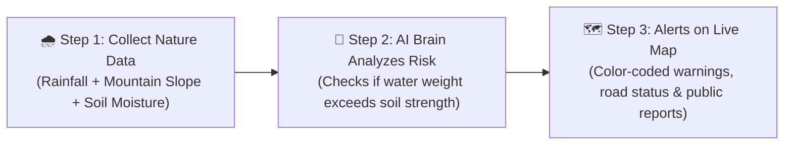

# ⛰️ AI-Based Early Warning & Landslide Risk Monitoring System in NER
### Ministry of Development of North Eastern Region (MDoNER) — Problem Statement ID: 26001

[](https://www.python.org/)
[](https://fastapi.tiangolo.com/)
[](https://scikit-learn.org/)
[](https://leafletjs.com/)
[](https://sqlite.org/)
[]()
[](https://github.com/ranjithbrs/ner-landslide-early-warning/actions/workflows/ci.yml)
[](PORTFOLIO.md)
[](LICENSE)

---

## 🌟 1. The 60-Second Summary (In Plain English)

### 🌧️ The Real Problem
The **North Eastern Region (NER) of India** (Sikkim, Assam, Meghalaya, Nagaland, Arunachal Pradesh, Manipur, Mizoram, Tripura) is famous for its breathtaking hills, but every monsoon, heavy rain causes massive landslides. 
- Mountains collapse onto major highways (like NH-10 in Sikkim and NH-29 in Nagaland).
- Ambulances, trucks, and school buses get stuck for days.
- Villages get cut off from food, medicine, and electricity.
- Traditionally, authorities only find out **after** the mountain has already fallen.

### 🛡️ What This System Does
This software is an **AI-powered digital warning bell for mountains**.
Instead of waiting for a disaster to happen, it constantly combines **weather forecasts**, **slope steepness**, and **underground soil sensors** to predict which hills are getting dangerous **hours before they slide**. 

Think of it like a **traffic light system for mountain safety**:
- 🟢 **Green (Normal)**: Everything is safe. Roads are clear.
- 🟡 **Yellow (Be Careful)**: Ground is getting soaked from continuous rain. Drivers should stay alert.
- 🟠 **Orange (High Risk)**: High danger of rockfalls. Heavy trucks and buses should pause.
- 🔴 **Red (Evacuate / Close Road)**: Immediate collapse predicted! Sirens sound, traffic is stopped, and lives are saved.

---

## 🚀 2. How It Works (The 3 Simple Steps)



1. **Step 1: Listening to Nature (Data Ingestion)**
   - How steep is the mountain? (Terrain height & slope).
   - How much did it rain yesterday, and how hard is it raining right now? (Rain gauge data).
   - Is the soil soaked like a full sponge? (Underground IoT moisture sensors).
   - Is the mountain tilting or moving? (Ground tilt sensors).

2. **Step 2: The AI Brain Computes Risk (Machine Learning)**
   - The AI model was trained on historical mountain failure patterns across 15 critical highway corridors.
   - It calculates a score from **0 to 100** called the **Dynamic Landslide Hazard Index (DLHI)**.
   - We specifically trained the AI to have **95.89% Recall** — which means it prioritizes safety above all else and almost never misses an incoming danger.

3. **Step 3: Taking Action on a Live Map (Tactical Dashboard)**
   - Shows the entire North East on an interactive map with satellite view.
   - Disaster officials can see pulsing warning lights (`⚠️`) on vulnerable highways.
   - Citizens and bus drivers can tap their phones to report fallen rocks or cracks on the road with photos and GPS.

---

## 🎮 3. Try It Yourself in 1 Minute (No Coding Required!)

If you are on Windows, you don't need any programming tools installed:

1. **Double-click the [`run.bat`](run.bat) file** in the project folder.
2. A stylish tactical map will automatically pop open in your browser at:  
   👉 **[http://127.0.0.1:8000/](http://127.0.0.1:8000/)**
3. **Play with the Live Storm Simulator**:
   - On the left panel, find the **Stress Simulation Sandbox**.
   - Drag the rainfall slider from `20mm` up to `180mm` (a torrential monsoon storm).
   - Click **"Recalculate AI Risk"** — watch the AI instantly flip the warning from 🟢 Green to 🔴 Red!

---

## 👥 4. Who Does This Help?

| User | How It Helps Them in Real Life |
| :--- | :--- |
| 🚗 **Everyday Drivers & Tourists** | Check road status before traveling through mountain passes like Gangtok or Kohima so they never get trapped. |
| 🚨 **Disaster Management Officers (DDMA / SDMA)** | Receive proactive warnings hours before a landslide happens to dispatch response teams early. |
| 🚧 **Border Roads Organisation (BRO) & Police** | Close dangerous stretches of highway before a collapse occurs, preventing casualties. |
| 📱 **Local Mountain Residents** | Report ground cracks, rockfalls, and road damage straight from their phones to alert authorities instantly. |

---

## 🗺️ 5. What You See on the Screen (Dashboard Walkthrough)

- 🛰️ **Crystal-Clear Satellite & Tactical Dark Map**: Crisp satellite imagery of the Himalayas and North East terrain without any watermarks or clutter.
- ⚠️ **Pulsing Danger Beacons**: Glowing pins pinpointing exact high-risk catchments (like the Paglajhora stretch on NH-10 or Phesama on NH-29).
- 🛣️ **Highway Status Indicators**:
  - 🟢 **Open**: Safe for all transit.
  - 🟡 **Single-Lane**: Controlled traffic; minor debris cleared.
  - 🟠 **High Risk**: Emergency transit only.
  - 🔴 **Blocked**: Road completely closed due to active debris.
- 📱 **Citizen Field Report Box**: A one-click button where anyone on the ground can type a quick message (e.g. *"Small mudslide near Km 42"*), pick a severity level, and drop a pin on the map.

---

## 🛠️ 6. For Developers, Evaluators & Engineers (Technical Deep-Dive)

*(If you are an engineer, researcher, or evaluator looking for technical details, this section covers the architecture, math, machine learning, and APIs).*

### 6.1 End-to-End System Architecture

```mermaid
flowchart TD
    subgraph DataSources [Multi-Source Data Ingestion]
        D1[SRTM / DEM Derivatives: Slope, Aspect, TWI, Curvature]
        D2[IMD Weather Telemetry: 24h & 72h Antecedent Rain]
        D3[IoT Ground Telemetry: Moisture, Pore Pressure, Tilt Rate]
        D4[Citizen & Field Official Hazard Reports]
    end

    subgraph MLEngine [Machine Learning & Prediction Core]
        M1[ColumnTransformer: Median Impute + StandardScale + OneHot]
        M2[Random Forest Classifier: Spatial Susceptibility]
        M3[Dynamic Hazard Index DLHI Calculator 0 - 100]
        M4[Early Warning Router: Green / Yellow / Orange / Red]
    end

    subgraph BackendAPI [FastAPI Modular Backend Services]
        B1[GET /api/v1/risk/zones - OGC GeoJSON Polygons]
        B2[GET /api/v1/roads/geojson - LineStrings with Status]
        B3[GET /api/v1/sensors/geojson - IoT Station Points]
        B4[POST/GET /api/v1/reports - Crowdsourced Hazard Sync]
        B5[GET /api/v1/health - System Diagnostics]
    end

    subgraph FrontendUI [Responsive Interactive GIS Dashboard]
        F1[Leaflet.js Viewport: Esri Dark Canvas & Satellite]
        F2[Vulnerable Corridor Ranking Matrix]
        F3[Interactive ML Stress Simulation Sandbox]
        F4[Field Hazard Submission Drawer & Feed]
    end

    DataSources --> MLEngine
    MLEngine --> BackendAPI
    BackendAPI <--> FrontendUI
```



---

### 6.2 Machine Learning Rigor & Evaluation

#### Dataset Grounding:
The dataset was synthetically generated using empirical geomorphological and hydrological probability distributions calibrated to 15 representative vulnerable corridors across the 8 NER states ($N=6,000$ samples; $4,800$ train / $1,200$ test; 24.3% positive failure rate). Data was strictly split **before** fitting imputers, encoders, and scalers to prevent data leakage.

#### Model Architecture & Hyperparameters:
- **Preprocessing**: `ColumnTransformer` with `SimpleImputer(strategy="median")` + `StandardScaler` for 14 continuous terrain/weather/sensor features; `SimpleImputer(strategy="most_frequent")` + `OneHotEncoder(handle_unknown="ignore")` for 2 categorical geology features.
- **Classifier**: `RandomForestClassifier` (120 estimators, `max_depth=14`, `min_samples_split=6`, `min_samples_leaf=2`, `class_weight="balanced"`, `random_state=42`).

#### Model Comparison Matrix:
In landslide forecasting, **a False Negative is catastrophic** (failure to alert before collapse), whereas a False Positive causes a temporary road caution. Therefore, models were benchmarked with an emphasis on **Recall**:

| Metric | Naive Baseline (Majority) | Logistic Regression Baseline | **Random Forest Classifier (Selected)** |
| :--- | :---: | :---: | :---: |
| **Accuracy** | 75.67% | 97.50% | **94.92%** |
| **Precision** | 0.00% | 94.56% | **85.11%** |
| **Recall (Sensitivity)** | 0.00% | 95.21% | **95.89%** |
| **F1-Score** | 0.0000 | 0.9488 | **0.9018** |
| **ROC-AUC Score** | 0.5000 | 0.9970 | **0.9934** |
| **5-Fold Cross-Validation** | N/A | $0.9968 \pm 0.0006$ | **$0.9939 \pm 0.0010$** |

#### Production Confusion Matrix (Holdout Test Set, $N = 1,200$):

| Predicted \ Actual | Stable Slope (Actual 0) | Landslide Event (Actual 1) | Row Total |
| :--- | :---: | :---: | :---: |
| **Predicted Stable (0)** | **859** (True Negative) | **12** (False Negative) | 871 |
| **Predicted Landslide (1)** | **49** (False Positive) | **280** (True Positive) | 329 |
| **Column Total** | 908 (75.7%) | 292 (24.3%) | **1,200** |

- **Recall**: $\frac{280}{280 + 12} = \mathbf{95.89\%}$ (280 out of 292 actual landslides detected).
- **Precision**: $\frac{280}{280 + 49} = \mathbf{85.11\%}$.
- **F1-Score**: $2 \times \frac{0.8511 \times 0.9589}{0.8511 + 0.9589} = \mathbf{0.9018}$.

#### Reproducibility Instructions:
```bash
# 1. Regenerate dataset and train/evaluate all models
python -m backend.ml_engine.train

# 2. Verify all 18 integration and ML tests
pytest tests/ -v
```

#### Top 8 Predictive Features:
```
1. rainfall_72h_antecedent_mm   24.13%  ████████████████████████
2. rainfall_24h_mm              20.89%  ████████████████████
3. rainfall_intensity_mm_h      19.31%  ███████████████████
4. soil_moisture_pct            17.11%  █████████████████
5. pore_water_pressure_kpa      10.01%  ██████████
6. slope_deg                     1.68%  █
7. tilt_rate_mm_h                1.54%  █
8. dist_to_fault_m               0.91%  ▌
```

---

### 6.3 Dynamic Landslide Hazard Index (DLHI) Formula

The real-time early warning score ($0 \text{ to } 100$) dynamically balances AI probability with immediate physical telemetry thresholds:

$$\text{DLHI} = 0.35 \times (\text{Prob}_{\text{ML}} \times 100) + 0.30 \times \min\left(\frac{R_{24\text{h}}}{R_{\text{crit}}} \times 100, 120\right) + 0.20 \times \min\left(\frac{SM_{\%}}{SM_{\text{crit}}} \times 100, 120\right) + 0.15 \times \min\left(\frac{\dot{\theta}}{2.0} \times 100, 150\right)$$

- 🟢 **GREEN ($\text{DLHI} < 30$)**: Normal surveillance. No immediate slope threat.
- 🟡 **YELLOW ($30 \le \text{DLHI} < 50$)**: Advisory. High moisture accumulation; caution advised.
- 🟠 **ORANGE ($50 \le \text{DLHI} < 75$)**: Alert. High hazard; freight restrictions and response standby.
- 🔴 **RED ($\text{DLHI} \ge 75$)**: Critical Warning. Imminent slope collapse; trigger sirens, road closures, and evacuation.

---

### 6.4 Project Directory Structure

```
ner-landslide-early-warning/
├── backend/
│   ├── app/
│   │   ├── api/v1/endpoints/       # Health, risk, roads, sensors, reports, alerts
│   │   ├── core/                   # Pydantic configuration & SQLite manager
│   │   ├── ml/                     # ML contracts & prediction service
│   │   └── main.py                 # FastAPI application root & static mounts
│   └── ml_engine/
│       ├── synthetic_generator.py  # NER-calibrated synthetic data generator
│       ├── pipeline.py             # Scikit-learn ColumnTransformer preprocessor
│       ├── train.py                # Cross-validation & model comparison
│       └── models/                 # Serialized joblib weights & model metadata
├── frontend/
│   ├── css/styles.css              # Tactical emergency operations theme
│   ├── js/app.js                   # Leaflet map engine & simulation sandbox
│   └── index.html                  # Dashboard HTML shell
├── tests/                          # 18 automated pytest verification tests
├── Dockerfile                      # Production container image definition
├── run.bat / run.ps1               # One-click Windows startup launchers
├── PORTFOLIO.md                    # Complete technical case study & resume bullets
└── requirements.txt                # Pinned dependencies
```

---

### 6.5 Getting Started & Installation

#### Option A: One-Click Startup (Windows)
Double-click `run.bat` or run in PowerShell:
```powershell
.\run.ps1
```

#### Option B: Manual CLI
```bash
# 1. Clone repository
git clone https://github.com/ranjithbrs/ner-landslide-early-warning.git
cd ner-landslide-early-warning

# 2. Set up virtual environment
python -m venv .venv

# On Windows:
.venv\Scripts\activate
# On Linux/macOS:
source .venv/bin/activate

# 3. Install dependencies
pip install -r requirements.txt

# 4. Run application
python -m uvicorn backend.app.main:app --host 127.0.0.1 --port 8000 --reload
```

#### Option C: Docker Container
```bash
docker build -t ner-landslide-system .
docker run -d -p 8000:8000 --name landslide-app ner-landslide-system
```

- **Live Dashboard**: [http://127.0.0.1:8000/](http://127.0.0.1:8000/)
- **Swagger API Docs**: [http://127.0.0.1:8000/docs](http://127.0.0.1:8000/docs)
- **Health Check API**: [http://127.0.0.1:8000/api/v1/health](http://127.0.0.1:8000/api/v1/health)

---

### 6.6 Automated Test Suite (18/18 Tests Passing)

Verify the system with Pytest:
```bash
pytest tests/ -v
```

```
tests/test_foundation.py::test_settings_loaded PASSED                    [  5%]
tests/test_foundation.py::test_database_tables_exist PASSED              [ 11%]
tests/test_foundation.py::test_health_check_endpoint PASSED              [ 16%]
tests/test_foundation.py::test_ml_schemas_and_fallback_predictor PASSED  [ 22%]
tests/test_foundation.py::test_incident_reporting_workflow PASSED        [ 27%]
tests/test_foundation.py::test_sensor_telemetry_workflow PASSED          [ 33%]
tests/test_foundation.py::test_frontend_static_serving PASSED            [ 38%]
tests/test_gis_endpoints.py::test_risk_zones_geojson_structure PASSED    [ 44%]
tests/test_gis_endpoints.py::test_road_corridors_geojson_structure PASSED [ 50%]
tests/test_gis_endpoints.py::test_sensors_geojson_structure PASSED       [ 55%]
tests/test_gis_endpoints.py::test_reports_geojson_structure PASSED       [ 61%]
tests/test_gis_endpoints.py::test_risk_summary_endpoint PASSED           [ 66%]
tests/test_ml_pipeline.py::test_synthetic_dataset_properties PASSED      [ 72%]
tests/test_ml_pipeline.py::test_preprocessing_pipeline_fit_transform PASSED [ 77%]
tests/test_ml_pipeline.py::test_trained_model_loading_and_metrics PASSED [ 83%]
tests/test_ml_pipeline.py::test_prediction_service_high_risk_scenario PASSED [ 88%]
tests/test_ml_pipeline.py::test_prediction_service_low_risk_scenario PASSED [ 94%]
tests/test_ml_pipeline.py::test_api_predict_endpoint_live PASSED         [100%]

======================= 18 passed in 5.27s =======================
```

---

### 6.7 REST API Catalog

| Method | Endpoint | Description | Sample Output |
| :--- | :--- | :--- | :--- |
| `GET` | `/api/v1/health` | System diagnostics & ML status | `{"status": "healthy", "ml_service_status": "loaded"}` |
| `GET` | `/api/v1/risk/summary` | Regional hazard overview | Top corridor, active warnings tally |
| `GET` | `/api/v1/risk/zones` | Monitored slope catchments as GeoJSON | Polygons styled with real-time DLHI |
| `POST` | `/api/v1/risk/predict` | Real-time AI prediction for inputs | Failure %, DLHI index, Warning tier |
| `GET` | `/api/v1/roads/geojson`| Highway corridors as GeoJSON | LineStrings with blockage & risk status |
| `GET` | `/api/v1/sensors/geojson`| IoT ground monitoring telemetry as GeoJSON | Points with moisture %, pore pressure, tilt |
| `POST` | `/api/v1/reports/` | Submit crowdsourced field hazard report | Persisted to SQLite, drops GIS map pin |
| `GET` | `/api/v1/reports/geojson`| Field observations as GeoJSON | Hazard markers with descriptions |
| `POST` | `/api/v1/reports/batch-sync`| Offline queued reports bulk ingestion | Syncs records captured without connectivity |

---

## 🏛️ 7. Government & Hackathon Alignment

- **Ministry**: Ministry of Development of North Eastern Region (MDoNER)
- **Problem Statement ID**: 26001
- **Domain**: AI-Based Disaster Management & Early Warning
- **Target Beneficiaries**:
  - District Disaster Management Authorities (DDMAs across the 8 NER states)
  - Border Roads Organisation (BRO) & State PWDs
  - National Disaster Response Force (NDRF 1st & 12th Bns)
  - Mountain logistics, passenger transit, and local communities

---

## 📄 8. License

This project is licensed under the MIT License — see the [LICENSE](LICENSE) file for details.
